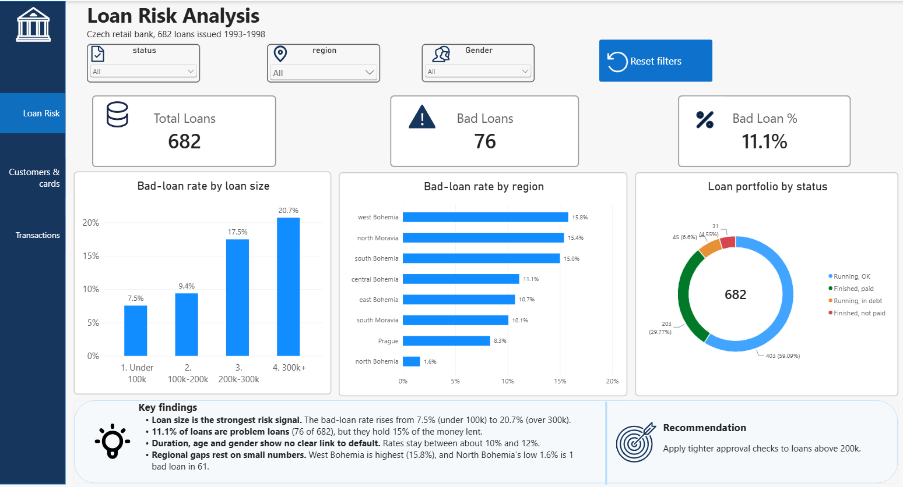
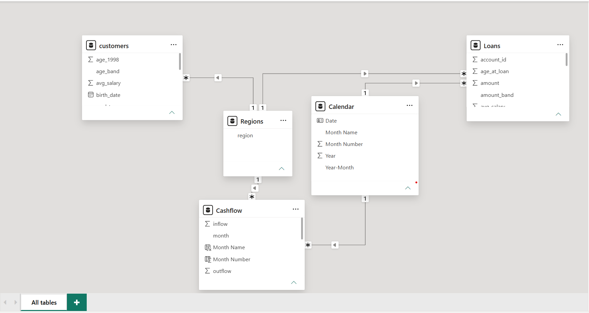
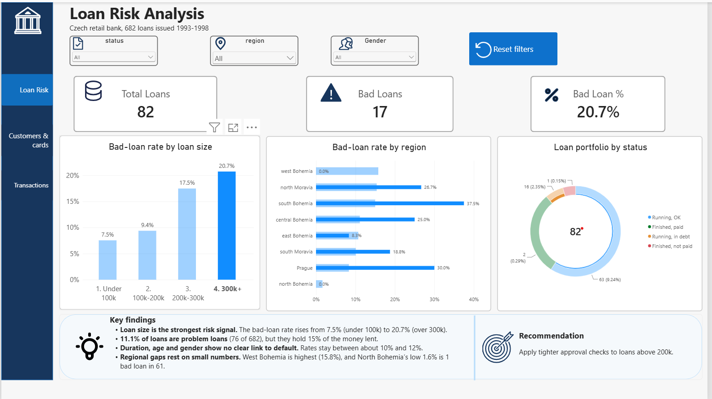
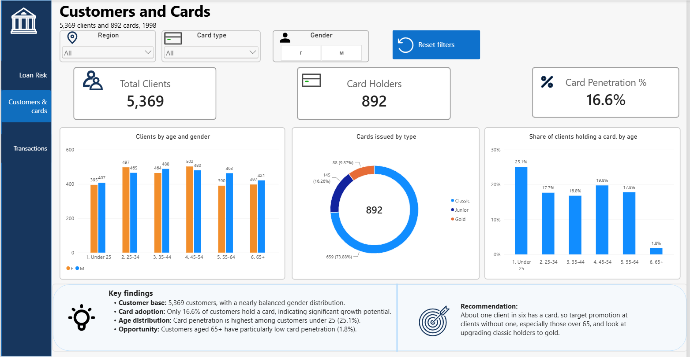
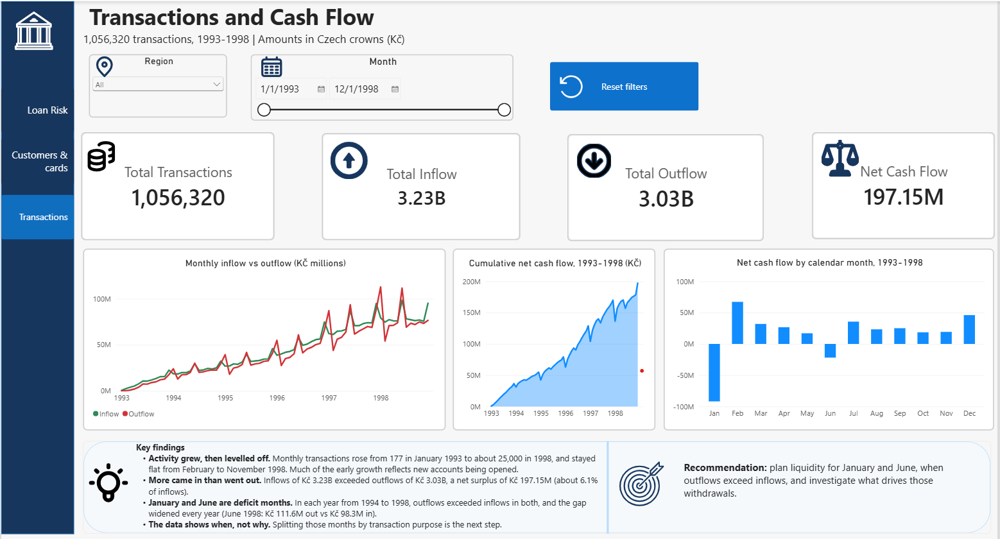

# Retail Bank Analysis: Loan Risk, Customers and Cash Flow

**PostgreSQL + Power BI | 1,056,320 transactions, 682 loans, 5,369 clients**

**Peter Ndung'u Ngari** | [linkedin.com/in/ngari-n-peter](https://www.linkedin.com/in/ngari-n-peter) | [github.com/NgaripeterN](https://github.com/NgaripeterN) | [ngari.n.peter@gmail.com](mailto:ngari.n.peter@gmail.com)

An end-to-end analytics project on a real, anonymised Czech retail bank. Raw CSV files are loaded into PostgreSQL, cleaned and modelled with SQL, and presented in an interactive three-page Power BI dashboard that answers questions a bank's management would ask about loan risk, its customer base and its cash flow.



---

## Business problem

Management of a retail bank wants to know:

1. **Which loans go bad, and why?** Is the risk driven by loan size, duration, borrower profile or region?
2. **Who are the customers, and who holds which credit cards?**
3. **How does money flow through the bank over time**, and are there periods of liquidity pressure?

## Dataset

**The Berka dataset** (PKDD'99 Discovery Challenge), prepared by Petr Berka and Marta Sochorova. It describes a Czech bank from 1993 to 1998 across 8 linked tables.

| Table | Rows | Describes |
|---|---|---|
| account | 4,500 | Accounts and statement frequency |
| client | 5,369 | Clients (birth number encodes gender and birth date) |
| disp | 5,369 | Links clients to accounts (owner or disponent) |
| district | 77 | Demographics and economy of each district |
| loan | 682 | Loans, with repayment status A to D |
| card | 892 | Credit cards (junior, classic, gold) |
| order | 6,471 | Standing payment orders |
| trans | 1,056,320 | Every transaction |

Source: "The Berka Dataset" on Kaggle (CC0, Public Domain), a copy of the original PKDD'99 data, which is described at https://webpages.charlotte.edu/mirsad/itcs6265/group1/domain.html. All amounts are in Czech crowns (Kč).

## Approach

```
CSV files --> raw --> clean --> reporting views --> Power BI model --> dashboard
```

| Layer | What happens |
|---|---|
| `raw` | Eight CSVs imported with pgAdmin. Every column is TEXT, so the import cannot fail on odd dates or blanks. |
| `clean` | Types cast, dates converted, Czech codes translated into English labels, client details decoded, primary and foreign keys added. |
| `reporting` | Three views, one per dashboard page. The 1M-row transaction table is summarised in SQL, so Power BI never loads it. |
| Power BI | Import mode, shared Region and Calendar dimension tables, DAX measures, synced slicers and a sidebar page navigator. |

### Data cleaning highlights

- **Dates stored as numbers.** Values like `930101` were converted to real dates with `to_date('19' || date, 'YYYYMMDD')`. A fixed century prefix avoids PostgreSQL reading two-digit years such as 45 as 2045.
- **Gender and birth date hidden in one field.** The client birth number is `YYMMDD`, with 50 added to the month for women. A `CASE` expression decodes both.
- **Three kinds of blank.** Empty transaction fields were stored as NULL, as empty strings and as single spaces. `NULLIF(TRIM(col), '')` makes them all proper NULLs.
- **Missing values written as `?`** in the district table were converted to NULL.
- **Czech codes translated** into readable English labels (statement frequency, transaction type and operation, payment purpose, loan status).
- **Loan status turned into an analytical flag.** Statuses B (finished, not paid) and D (running, in debt) form `is_bad_loan`. B is a confirmed loss and D is an at-risk loan.
- **Joins protected against duplication.** Loans are joined to the account **Owner** only. An account can also have a second person (a disponent), and joining to both would count some loans twice.
- **Every layer reconciled.** Row counts were checked at each step (for example 682 loans and 76 bad loans in the loan view, 1,056,320 transactions in the cash flow view).

## Data model



A star schema: two **dimension tables** (`Regions`, `Calendar`) filter three **fact tables** (`Loans`, `customers`, `Cashflow`). All relationships are one-to-many with single-direction filtering. The facts have different grains (per loan, per client, per month and region), so they are never joined to each other directly, which prevents inflated counts.

| From | To | Cardinality |
|---|---|---|
| Regions[region] | Loans[region] | 1 : many |
| Regions[region] | customers[region] | 1 : many |
| Regions[region] | Cashflow[region] | 1 : many |
| Calendar[Date] | Loans[loan_date] | 1 : many |
| Calendar[Date] | Cashflow[month] | 1 : many |

One Region slicer, synced across all three pages, filters the whole report.

---

## Dashboard and findings

### Page 1: Loan Risk



**682 loans, of which 76 (11.1%) are problem loans.** Those 76 account for about 15% of the money lent, so the bad loans are bigger than average.

| Loan size | Loans | Bad-loan rate |
|---|---|---|
| Under 100k | 305 | 7.5% |
| 100k to 200k | 192 | 9.4% |
| 200k to 300k | 103 | 17.5% |
| 300k and above | 82 | 20.7% |

- **Loan size is the strongest risk signal.** Loans above 200k go bad roughly 2.5 times as often as loans under 100k.
- **Duration, borrower age and gender show no clear link to default.** Loans of 24 months and longer sit between 11.5% and 12.3% (12-month loans are lower at 8.4%, on only 11 bad loans). Age bands range from 10.1% to 11.8%, and gender from 10.5% (male) to 11.8% (female).
- **Regional gaps rest on small numbers.** West Bohemia (15.8%), North Moravia (15.4%) and South Bohemia (15.0%) are highest. North Bohemia is lowest at 1.6%, which is **one bad loan out of 61**.
- **District economics do not explain regional risk.** The region with the highest unemployment (North Bohemia, 6.52%) has the lowest bad-loan rate, and two of the three riskiest regions (West and South Bohemia, about 2.7% to 2.8%) have below-average unemployment.

### Page 2: Customers and Cards



- **A balanced client base.** 5,369 clients, 51% male and 49% female, spread evenly across age groups (largest group: 45 to 54, with 982 clients).
- **Few clients hold a card.** 892 of 5,369 (16.6%).
- **Classic cards dominate.** 659 classic (73.9%), 145 junior (16.3%) and 88 gold (9.9%).
- **Age does not decide who gets the premium card.** Classic and gold holders have almost the same average age (43 and 44). Junior holders average 19.
- **Card holding peaks under 25 (25.1%, helped by junior cards) and almost disappears after 65 (1.8%).**

### Page 3: Transactions and Cash Flow



- **Activity grew, then levelled off.** Monthly transactions rose from 177 in January 1993 to about 25,000 in 1998 and stayed flat from February to November 1998. Much of the early growth reflects new accounts being opened.
- **More came in than went out.** Inflows of Kč 3.23B exceeded outflows of Kč 3.03B, a net surplus of Kč 197.15M (about 6.1% of inflows).
- **January and June are deficit months.** In every year from 1994 to 1998, outflows exceeded inflows in both, and the gap widened each year. In June 1998, Kč 111.6M went out against Kč 98.3M in. In January 1998 it was Kč 112.8M out against Kč 79.3M in.
- **The data shows when, not why.** Splitting these months by transaction purpose is the natural next step.

---

## Recommendations

1. **Apply tighter approval checks to loans above 200k.** They are 27% of loans but 46% of problem loans (35 of 76).
2. **Monitor West Bohemia, North Moravia and South Bohemia**, but treat the regional gaps as signals to watch, not proof, because they rest on small numbers.
3. **Plan liquidity for January and June**, when outflows exceed inflows, and investigate what drives those withdrawals.
4. **Target card promotion at the 83% of clients without a card**, especially clients over 65, and look at upgrading classic holders to gold.

## Limitations

- **Association, not causation.** Large loans go bad more often, but size may stand in for other factors, such as client income, that the data does not contain.
- **Small samples.** Several segments (single regions, the 60+ age band, 12-month loans) have only a handful of bad loans, so their rates move a lot on one or two cases.
- **Ages are as of 31 December 1998**, the end of the data, and age at loan date is used for the loan analysis.
- **District crime figures are raw counts**, not rates per resident, so they were not used to rank regions.
- **No reason codes for the January and June deficits.** The data shows the pattern but not its cause.
- The data covers one bank over 1993 to 1998 and may not describe banking today.

## DAX measures

```dax
-- Loans
Total Loans = COUNTROWS(Loans)
Bad Loans = SUM(Loans[bad_loan_flag])
Bad Loan % = DIVIDE([Bad Loans], [Total Loans])

-- Customers
Total Clients = COUNTROWS(customers)
Card Holders = SUM(customers[has_card_flag])
Card Penetration % = DIVIDE([Card Holders], [Total Clients])

-- Cash flow
Total Transactions = SUM(Cashflow[transactions])
Total Inflow = SUM(Cashflow[inflow])
Total Outflow = SUM(Cashflow[outflow])
Net Cash Flow = [Total Inflow] - [Total Outflow]
Running Net Flow =
CALCULATE(
    [Net Cash Flow],
    FILTER(ALL(Cashflow[month]), Cashflow[month] <= MAX(Cashflow[month]))
)

-- Dimension tables
Regions = DISTINCT(Customers[region])
Calendar =
ADDCOLUMNS(
    CALENDAR(DATE(1993,1,1), DATE(1998,12,31)),
    "Year", YEAR([Date]),
    "Month Number", MONTH([Date]),
    "Month Name", FORMAT([Date], "mmm"),
    "Year-Month", FORMAT([Date], "yyyy-mm")
)
```

The running total is a DAX measure, not a SQL column, so it responds to the slicers.

## Repository structure

```
berka-bank-analysis/
├── README.md
├── screenshots/                 dashboard and data model screenshots
└── sql/
    ├── 01_create_raw_tables.sql   staging tables (all TEXT)
    ├── 02_clean_and_model.sql     types, dates, labels, keys
    ├── 03_analysis_queries.sql    the analysis, in the order it was run
    └── 04_reporting_views.sql     three views that feed Power BI
```

## How to reproduce

1. Create a PostgreSQL database (for example `bank_db`) and download the Berka CSV files.
2. Run `01_create_raw_tables.sql`, then import each CSV into its `raw` table with pgAdmin (Import/Export Data, Header: Yes, Delimiter `;`, Quote `"`). `order.csv` goes into `raw.orders`.
3. Run `02_clean_and_model.sql`, then `04_reporting_views.sql`. `03_analysis_queries.sql` holds the exploratory queries.
4. In Power BI Desktop, connect to PostgreSQL in **Import** mode and load the three `reporting` views.
5. Create the `Regions` and `Calendar` tables and the relationships above, then add the measures.

## Skills demonstrated

- **SQL (PostgreSQL):** multi-table joins, CTEs, window functions, `CASE` logic, date functions (`date_trunc`, `age`), NULL handling, constraints, indexes and views.
- **Data cleaning and modelling:** a raw, clean and reporting layered design with reconciliation checks at each step.
- **Power BI:** star-schema modelling, relationships, DAX measures (including a running total), a date table, synced slicers and page navigation.
- **Analytical judgement:** reporting what the data does not show, flagging small samples and separating association from causation.

---

**Author:** Peter Ndung'u Ngari | [linkedin.com/in/ngari-n-peter](https://www.linkedin.com/in/ngari-n-peter) | [github.com/NgaripeterN](https://github.com/NgaripeterN) | [ngari.n.peter@gmail.com](mailto:ngari.n.peter@gmail.com)
